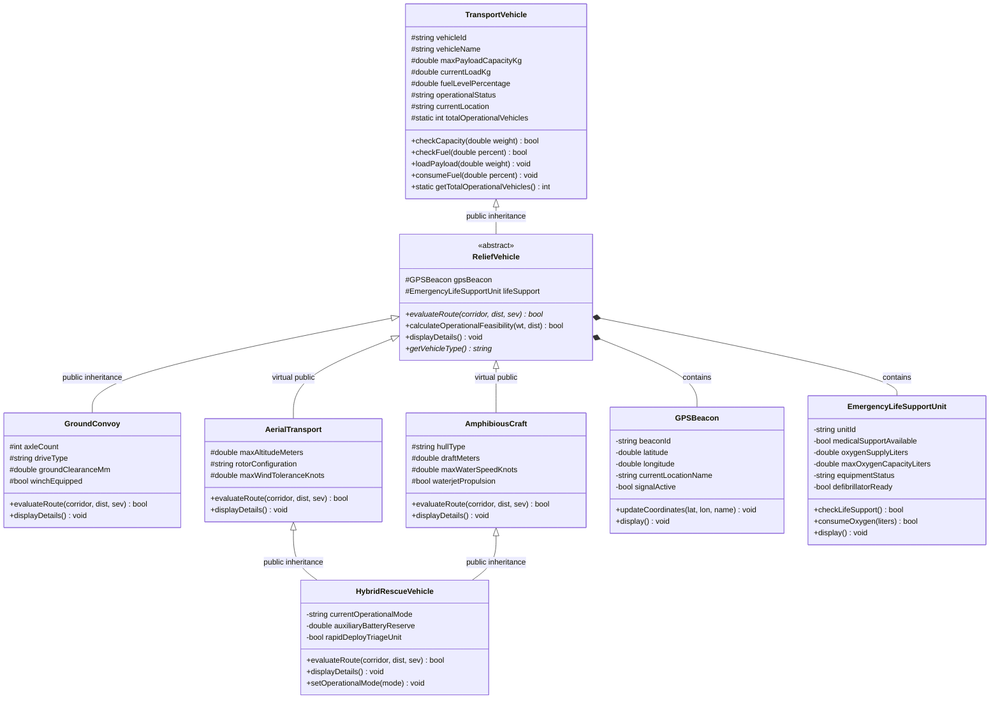
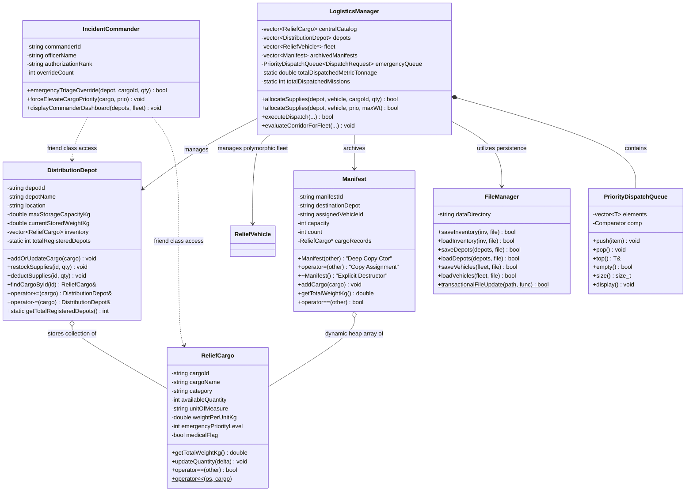
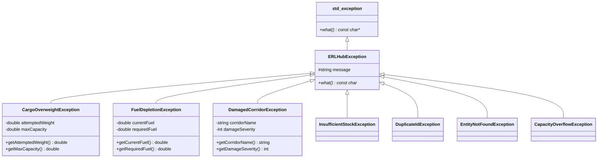

# UML Class Diagram & Architecture Specifications
## Post-Earthquake Multi-Agency Emergency Relief Logistics Hub (ERL-HUB)

The following Mermaid diagrams illustrate the class hierarchy, inheritance relationships (including resolution of the Diamond Problem via virtual base classes), containership (composition), and associations across the ERL-HUB software architecture.

---

## 1. Core Vehicle Hierarchy & Diamond Inheritance

---

## 2. Inventory, Depot, Manifest, and Friend Class Associations

---

## 3. Custom Exception Hierarchy

